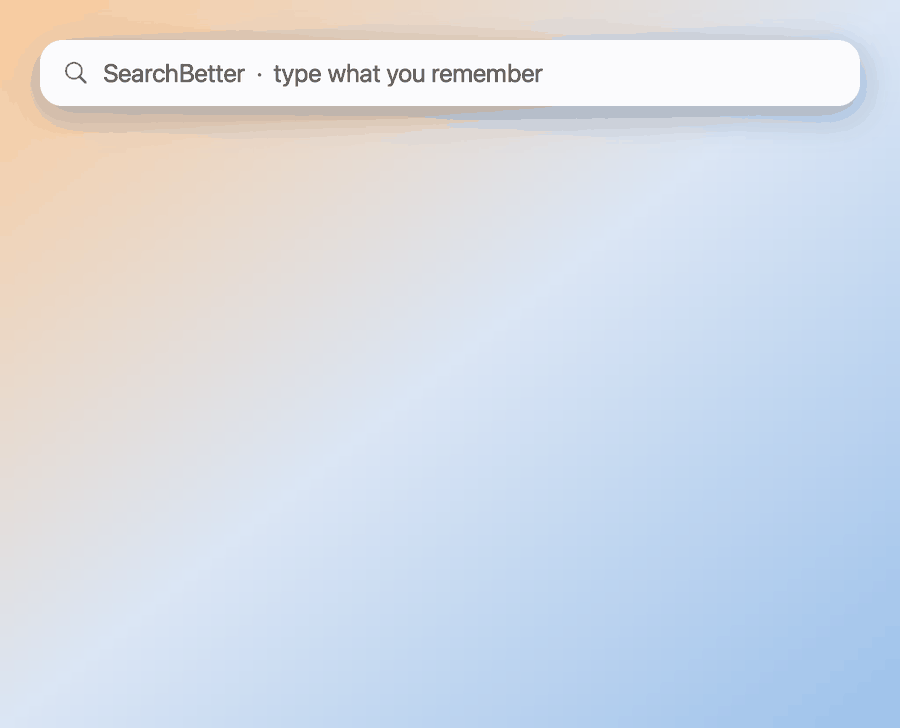
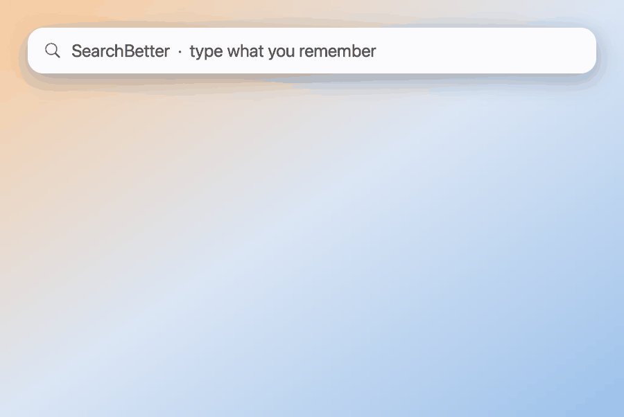

# SearchBetter

Search your Mac by typing what you remember. Press Option + Space and type "code that sends the welcome email" or "cat on a sofa", and SearchBetter looks at file names, the words inside your files, and what your documents, code and images are about. The AI model runs on your Mac, and your files stay there.

**[Download SearchBetter](https://github.com/krishna-goutham-tls/searchbetter/releases/latest/download/SearchBetter.dmg)**

It needs a Mac with Apple silicon (M1 or later) and macOS 14 or later. So far it has been tested only on macOS 26.

## What a search looks like

Find a photo by what it shows:

Find a document by what it is about. This file never uses the word "refund":

Find a file by the words inside it:

Each frame is the real app's result for the letters typed so far, on a demo folder of 126 files. The footer shows the real search time.

## Install

Open the disk image and drag SearchBetter to Applications. The app has no Apple Developer ID yet, so macOS will most likely block it the first time. If it does, click Done, go to System Settings > Privacy & Security, scroll down and click Open Anyway.

### Install with an AI agent

If you use Claude Code, Codex or another agent that can run commands, ask it to install SearchBetter. These are the steps it runs:

    curl -L -o /tmp/SearchBetter.dmg https://github.com/krishna-goutham-tls/searchbetter/releases/latest/download/SearchBetter.dmg
    hdiutil attach -nobrowse -quiet /tmp/SearchBetter.dmg
    ditto /Volumes/SearchBetter/SearchBetter.app /Applications/SearchBetter.app
    hdiutil detach -quiet /Volumes/SearchBetter
    xattr -dr com.apple.quarantine /Applications/SearchBetter.app
    open /Applications/SearchBetter.app

The `xattr` line lifts the macOS download block for this one app, the same thing Open Anyway does. After the app opens, you finish the rest yourself: the setup screen downloads the search model, and macOS asks once for each folder.

On first open, the setup screen downloads a 310 MB search model. macOS then asks for access to Desktop, Documents and Downloads, once for each folder.

The first read of your files can take 15 minutes or more. File names are searchable right away, and search finds more as the reading goes on. Keep the Mac plugged in for this. Below 50% battery, the reading waits for power.

## What it reads and where the data goes

The model download is the only time the app uses the internet. Search runs on your Mac through a local copy of `llama-server`, and the app sends nothing else out.

It reads your home folder, except hidden folders, `~/Library` and build folders such as `node_modules`. It does not read key files, or files with `secret`, `password`, `token`, `credential` or `api_key` in the name. The index is at `~/Library/Application Support/mac-search/`, and deleting that folder removes all of it.

There is more detail in [app/README.md](app/README.md).

## Build it yourself

You need the Xcode Command Line Tools. Xcode itself is not needed.

    cd app
    ./build.sh
    open build.noindex/SearchBetter.app

`./make-dmg.sh` builds the disk image.

## Licence

SearchBetter is under the MIT licence. It uses [llama.cpp](https://github.com/ggml-org/llama.cpp) (MIT) and the [EmbeddingGemma 2](https://huggingface.co/ggml-org/embeddinggemma-2-GGUF) model (Apache 2.0). Their licence texts are in `app/Resources/licenses/` and inside the app.
